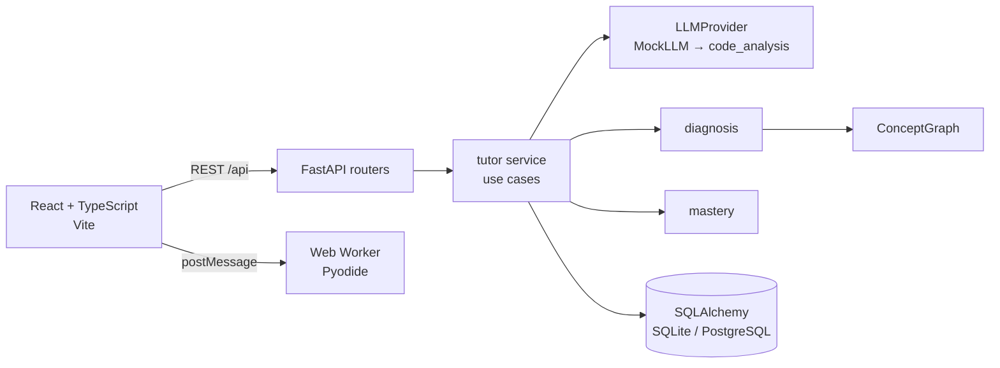

# MindLattice

**Find out *why* a student can't learn a topic, not just *that* they can't.**

When a student keeps failing at `for` loops, the problem is often somewhere else: they may not
understand that `total = total + n` builds on the old value. MindLattice reads the student's code,
detects the misconception, walks a **knowledge dependency graph** to find the most fundamental
missing concept (the *root cause*), and generates targeted **micro exercises** for it.

```
Student code ──► misconception ──► knowledge graph ──► root cause ──► micro exercises
 total = n        "accumulator      variable-update      "updating a      3 short questions
                   overwritten"      → loop-logic          variable"       on that concept
                                     → for-loops
```

## Features

- **Static code analysis** with Python's `ast` module. Student code is parsed, **never executed**.
  Rules detect overwritten accumulators, `=` vs `==`, exclusive `range` stops, off-by-one indexing,
  infinite `while` loops, `print` inside a loop, and `return` inside a loop.
- **Run code in the browser** with [Pyodide](https://pyodide.org) (CPython compiled to WebAssembly)
  inside a Web Worker. Output is compared with the expected result; code that runs longer than
  5 seconds (e.g. an infinite `while` loop) is stopped by terminating the worker. The server never
  executes student code.
- **Knowledge graph** of 18 Python-basics concepts with prerequisite edges (validated acyclic).
- **Student model**: one mastery score per concept, updated with an exponential moving average.
  The update rate reflects how strong the evidence is (a pinpointed misconception counts more than
  a plain wrong answer).
- **Root-cause diagnosis**: among the weak concepts under the target, pick the most fundamental one
  whose own prerequisites are fine; break ties by misconception frequency. Returns a confidence
  level and "probe" concepts that have no evidence yet.
- **Micro exercises** chosen for the root cause; answers update mastery and the diagnosis.
- **Teacher dashboard**: most common root causes in the class, with per-student status.
- **Pluggable LLM layer**: everything "intelligent" goes through an `LLMProvider` interface. The
  default `MockLLM` works offline with no API key; a real model can be plugged in later.

## Architecture



| Layer | Path | Responsibility |
|---|---|---|
| Routers | `backend/app/routers/` | HTTP only: validate input, call a use case, shape the response |
| Use cases | `backend/app/services/tutor.py` | Submit attempt, diagnose, practice, class overview |
| Domain | `services/graph.py`, `mastery.py`, `diagnosis.py`, `code_analysis.py` | Pure logic, unit-tested without HTTP |
| LLM | `services/llm.py` | `LLMProvider` protocol + `MockLLM` |
| Data | `models.py`, `seed_data.py` | ORM models; concepts, problems and exercises as seed content |

### Design decisions

- **Never execute student code.** Running arbitrary code on a server needs a real sandbox. Static
  analysis is safe, fast and gives line-level feedback.
- **The graph is data, not code.** Concepts and edges live in the database, so new subjects can be
  added without touching the algorithms.
- **Explainable over clever.** Every diagnosis comes with the chain of concepts and the evidence
  (the finding in the student's code) that led to it.
- **Thin routers, testable services.** The domain modules have no FastAPI imports.

## Getting started

Requirements: Python 3.11+, Node.js 20+.

```bash
# 1. Backend  (http://localhost:8000, interactive docs at /docs)
cd backend
python -m venv .venv && source .venv/bin/activate   # Windows: .venv\Scripts\activate
pip install -r requirements.txt
uvicorn app.main:app --reload

# 2. Frontend  (http://localhost:5173, proxies /api to the backend)
cd frontend
npm install
npm run dev
```

`npm run dev` and `npm run build` first copy the Pyodide runtime from `node_modules` into
`public/pyodide` (see `frontend/scripts/copy-pyodide.mjs`), so the app works without a CDN.

On first start the database is created and seeded with the concept graph, five coding tasks,
27 micro exercises and a demo class of eight students (set `SEED_DEMO_DATA=false` to skip it).

Configuration (environment variables, see `backend/.env.example`):

| Variable | Default | |
|---|---|---|
| `DATABASE_URL` | `sqlite:///./mindlattice.db` | Any SQLAlchemy URL, e.g. PostgreSQL |
| `LLM_PROVIDER` | `mock` | LLM implementation |
| `SEED_DEMO_DATA` | `true` | Create the demo class |
| `CORS_ORIGINS` | `http://localhost:5173` | Comma-separated |

## API

| Method | Path | Description |
|---|---|---|
| GET | `/api/graph` | Concepts and prerequisite edges |
| GET | `/api/problems` | Coding tasks |
| POST | `/api/students` | Create a student |
| GET | `/api/students/{id}/mastery` | Mastery per concept |
| POST | `/api/students/{id}/attempts` | Submit code → findings, score changes, diagnosis |
| GET | `/api/students/{id}/diagnosis/{concept}` | Current root-cause diagnosis |
| POST | `/api/students/{id}/practice` | Micro exercises for a concept (answers hidden) |
| POST | `/api/students/{id}/exercises/{ex}/answer` | Check an answer, update mastery |
| GET | `/api/teacher/overview` | Class-wide root causes and student status |

## Tests

```bash
cd backend && pytest          # 39 tests: graph, analyser rules, mastery, diagnosis, API flows
cd frontend && npm run build  # type-check + production build
```

## Roadmap

- [ ] Real LLM provider (Claude or OpenAI) for subtler misconceptions and generated exercises
- [ ] Probe questions: ask about untested prerequisites before committing to a diagnosis
- [ ] Learn edge weights from data ("students weak in X are usually weak in Y")
- [ ] Spaced repetition for mastered concepts
- [ ] PostgreSQL + Docker Compose, authentication, deployment
